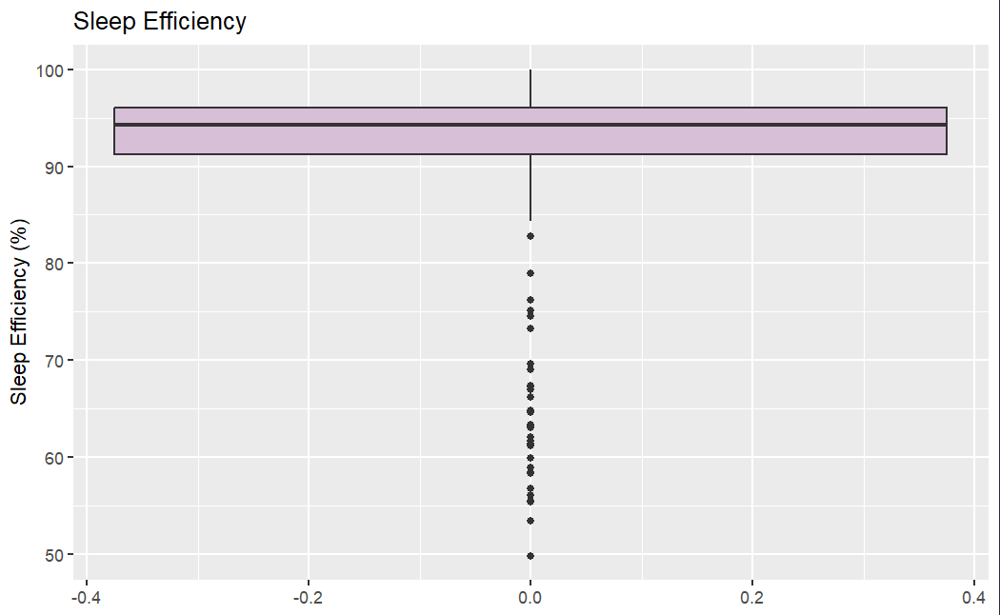
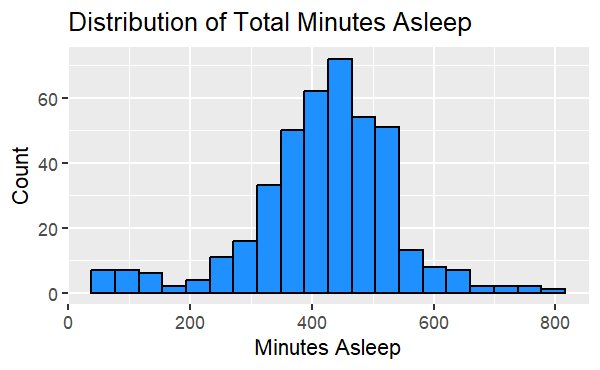
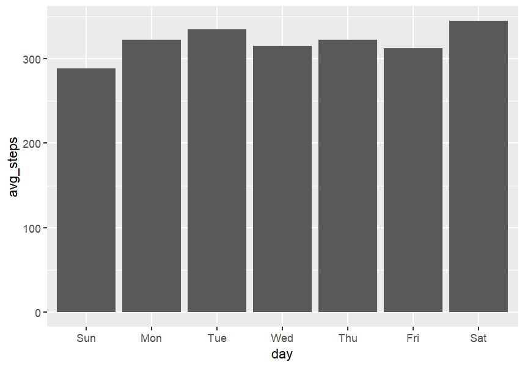
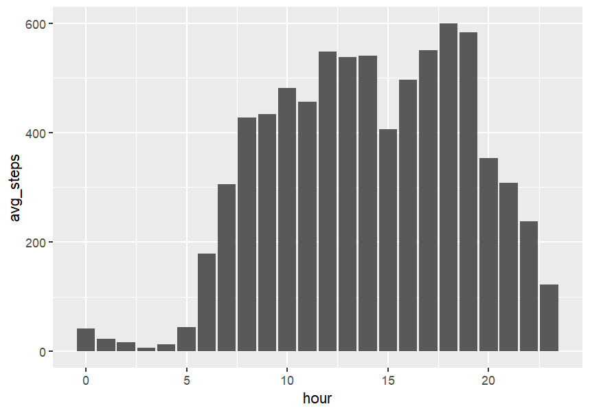
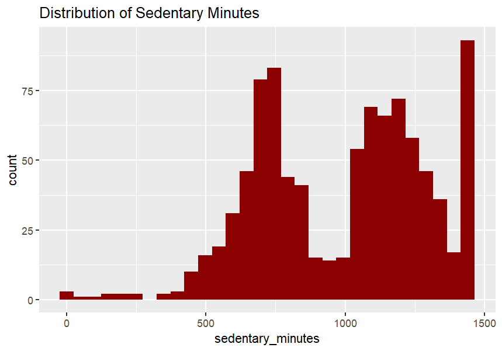
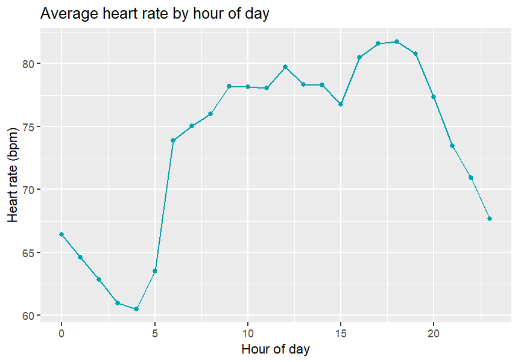

# Exploratory Data Analysis (EDA) Summary

The Fitbit dataset comprises 18 CSV files containing participant information at varying levels of granularity, including daily, hourly and minute-level observations. These datasets cover physical activity, step counts, calories burned, heart rate, sleep patterns and weight measurements. Initial exploratory analysis identified up to **33 unique participants**, although this representation varied across datasets. Most notably, the weight dataset contained records for only eight participants, limiting its representativeness and the reliability of broader conclusions.

## Sleep Analysis

Sleep analysis explored both total minutes asleep and sleep efficiency, calculated as the proportion of time spent in bed that participants were asleep. The distribution of sleep efficiency displayed generally high values, with most observations concentrated above 90%. However, several lower outliers were identified, suggesting considerable variation in individual sleep experiences. The distribution of minutes asleep was concentrated around 400–500 minutes, although observations at both extremes indicated variability in sleep duration. These findings suggest that sleep efficiency and duration provide complementary measures when evaluating sleep patterns.

Sleep efficiency was calculated using the below formula:

$$
\frac{\text{Minutes Asleep}}{\text{Time In Bed}} \times 100
$$

## Physical Activity

Analysis of daily step counts revealed relatively consistent activity levels throughout the week, with Saturday recording the highest average and Sunday the lowest. Hourly analysis revealed a more pronounced pattern, with activity increasing during the morning and reaching its highest levels around 18:00–19:00. This may reflect daily routines or increased leisure-time activity, although participants' employment status and schedules are unknown.

Sedentary behaviour was also investigated. The distribution of sedentary minutes demonstrated substantial variability, with concentrations at different activity levels. Some observations approached an entire day of sedentary time. However, without further investigation into device usage and recording practices, it is difficult to determine whether these reflect genuinely sedentary behaviour or potential measurement limitations.

## Heart Rate Analysis

Heart rate measurements revealed a distinct daily pattern, with lower average values during the early morning and higher values during the afternoon and evening. Notably, the evening increase broadly coincided with the peak in hourly step counts. This is consistent with the expected relationship between physical activity and heart rate, although these trends alone cannot establish a direct relationship at an individual level.

## Calories and Daily Steps

Exploration of the calorie datasets identified no missing values or duplicates in the files examined. As a result, step and calorie datasets were combined to support further investigation of potential relationships.

Daily step counts had a median of 7,406 steps, while daily calories burned had a median of 2,134 calories. Both distributions contained outliers, making the median a more appropriate measure of central tendency than the mean due to its resistance to extreme observations.

## Overall Findings

Overall, the EDA identified patterns in activity, sleep and heart rate, alongside variation between participants and datasets. Differences in participant coverage, potential recording limitations and the presence of outliers should be considered when interpreting these results. These findings provide a foundation for further analysis and the development of interactive visualisations that enable participant-level comparisons and exploration across different time periods.
