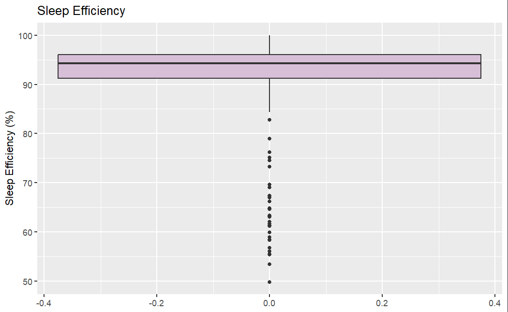
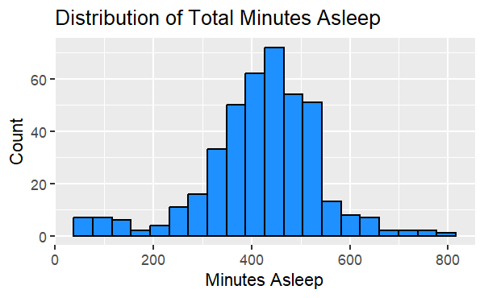
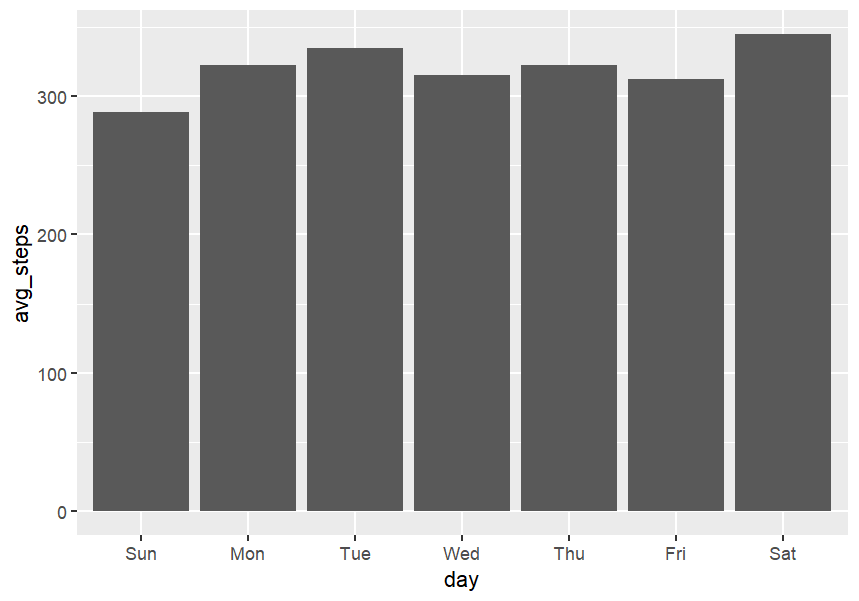
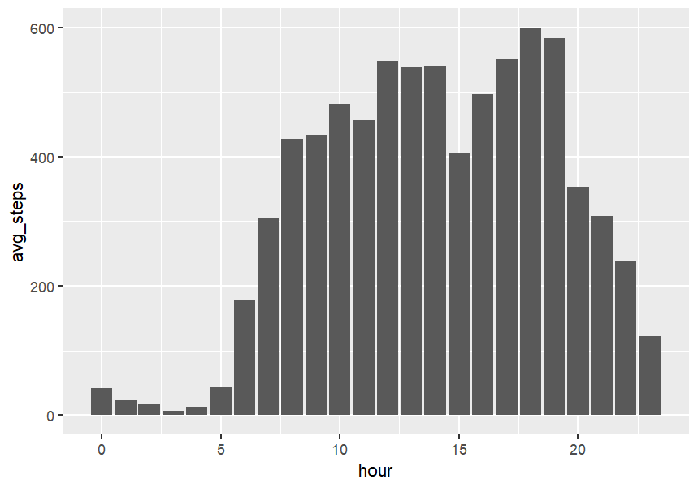
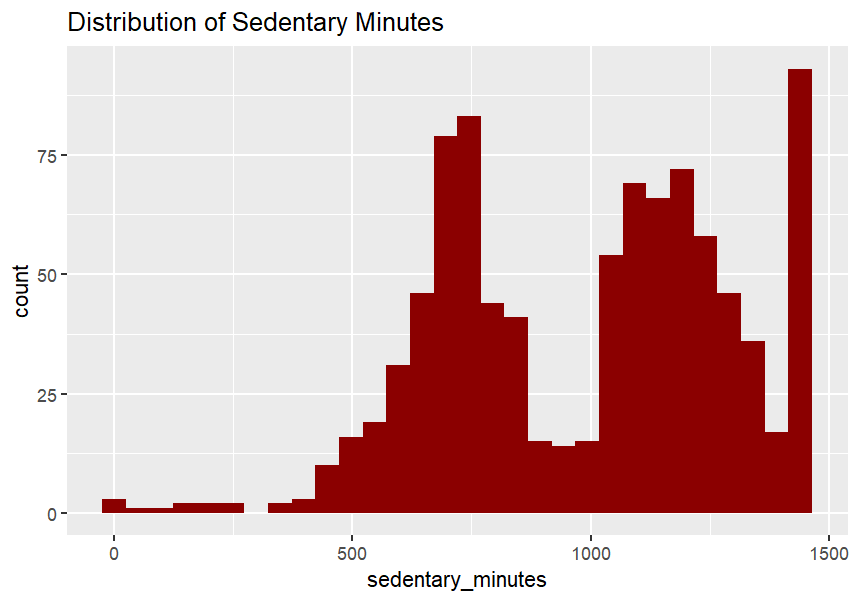
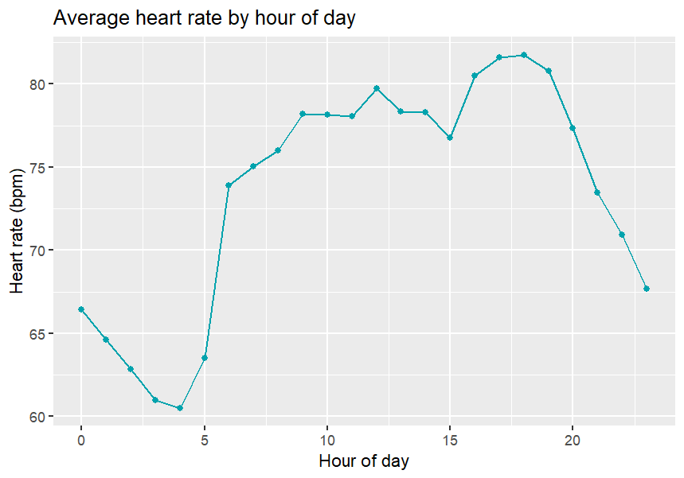

# TAG Task #1: Fitbit Dashboard

An interactive R Shiny dashboard for exploring Fitbit activity data, comparing performance within a friendship group, and identifying exercise habits over time.

## Contents

- [Project Context](#project-context)
- [Dashboard Concept and Scope](#dashboard-concept-and-scope)
- [Target Users](#target-users)
- [Data Source](#data-source)
- [Dashboard Questions and Features](#dashboard-questions-and-features)
- [Group Initial EDA summary](#group-initial-eda-summary)
- [Requirements](#requirements)
- [Dashboard Wireframes](#dashboard-wireframe)
- [Project Approach](#project-approach)
- [Project Folder Structure](#project-folder-structure)
- [How to Run Locally](#how-to-run-locally)
- [Retrospective Video](#retrospective-video)

## Project Context {#project-context}

Our TAG (Training Assessment Group) team was tasked with building an interactive dashboard that allows users to explore their Fitbit data alongside the data of others in their friendship group.

This project forms part of the DATA2007 team working skills assessment and provides preparation for the Assessed Group Project (AGP) in January 2027.

The sample data covers activity, heart rate, sleep, and movement for approximately 30 Fitbit users. For this prototype, we treat these users as a group of friends who want to understand their exercise habits and compare their progress.

## Dashboard Concept and Scope {#dashboard-concept-and-scope}

The dashboard is based on the idea of a shared fitness platform where friends can compare activity, identify trends, and stay motivated through shared progress.

The wider platform concept would allow users to:

- Create an account and join a friendship group.
- Connect their Fitbit device.
- Compare their performance with friends.
- Track progress over time.
- Explore their exercise habits and trends.

**Prototype scope:** This project focuses on exploring the supplied sample data as though its users belonged to a shared friendship group. Account creation, device connections, and group membership management are outside of this prototype’s scope.

The project uses **R Shiny** for the interactive dashboard and **R Markdown** or **R** for supporting analysis and reporting.

## Target Users {#target-users}

The primary users are athletes who want to understand their activity and compare performance within a friendship group.

In future, the platform could also support people beginning their fitness journey or users who want a personalised view of progress towards specific goals.

## Data Source {#data-source}

The prototype uses an open Fitbit dataset containing activity and health measurements from approximately 30 users who consented to share their data through a survey conducted via Amazon Mechanical Turk.

The dataset comprises 18 CSV files covering different measurement types, with observations recorded at minute, hourly and daily intervals. These include:

- Steps and activity intensity.
- Calories burned.
- Heart rate.
- Sleep.
- Weight and body measurements.

For this prototype, participants are treated as members of a shared friendship group to demonstrate the dashboard's functionality. However, this is a hypothetical scenario, and the participants are not known to have any personal connections. Furthermore, the dataset represents a relatively small, self-selected sample and should not be considered representative of the wider population.

### Date Range Clarification

During the initial exploratory data analysis (EDA), a discrepancy was identified between the date range specified in the task brief and the dates recorded in the dataset.

The task brief states:

> This dataset was generated by respondents ... between 03.12.2016–05.12.2016.

However, our exploration identified a minimum date of **12 April 2016** and a maximum date of **12 May 2016**.

This discrepancy is likely due to differences between American (MM/DD/YYYY) and British (DD/MM/YYYY) date conventions. The task brief appears to describe the period from 12 March to 12 May 2016, whereas the dates identified during our exploration cover 12 April to 12 May 2016.

For the prototype, we have used the dates recorded in the dataset rather than those specified in the task brief, ensuring that the dashboard reflects the available observations.

**Dataset link:** *To be added if available*

## Dashboard Questions and Features {#dashboard-questions-and-features}

The dashboard is designed to help users answer:

- Who is the most active member of the group?
- How do activity levels vary between users?
- On which days are users most active?
- What exercise patterns appear across the group?
- How do heart rate and calorie expenditure differ between users?

To support these questions, the dashboard aims to provide:

- Interactive visualisations of activity data.
- Comparisons between users.
- Individual and group performance metrics.
- Views of activity and progress over time.
- Insights into exercise habits and behaviour.

## Group Initial EDA Summary {#group-initial-eda-summary}

The Fitbit dataset comprises 18 CSV files containing participant information at varying levels of granularity, including daily, hourly and minute-level observations. These datasets cover physical activity, step counts, calories burned, heart rate, sleep patterns and weight measurements. Initial exploratory analysis identified up to **33 unique participants**, although this representation varied across datasets. Most notably, the weight dataset contained records for only eight participants, limiting its representativeness and the reliability of broader conclusions.

### Sleep Analysis

Sleep analysis explored both total minutes asleep and sleep efficiency, calculated as the proportion of time spent in bed that participants were asleep. The distribution of sleep efficiency displayed generally high values, with most observations concentrated above 90%. However, several lower outliers were identified, suggesting considerable variation in individual sleep experiences. The distribution of minutes asleep was concentrated around 400-500 minutes, although observations at both extremes indicated variability in sleep duration. These findings suggest that sleep efficiency and duration provide complementary measures when evaluating sleep patterns.





Sleep efficiency was calculated using the below formula:

$$
\frac{\text{Minutes Asleep}}{\text{Time In Bed}} \times 100
$$

### Physical Activity

Analysis of daily step counts revealed relatively consistent activity levels throughout the week, with Saturday recording the highest average and Sunday the lowest. Hourly analysis revealed a more pronounced pattern, with activity increasing during the morning and reaching its highest levels around 18:00-19:00. This may reflect daily routines or increased leisure-time activity, although participants' employment status and schedules are unknown.





Sedentary behaviour was also investigated. The distribution of sedentary minutes demonstrated substantial variability, with concentrations at different activity levels. Some observations approached an entire day of sedentary time. However, without further investigation into device usage and recording practices, it is difficult to determine whether these reflect genuinely sedentary behaviour or potential measurement limitations.



### Heart Rate Analysis

Heart rate measurements revealed a distinct daily pattern, with lower average values during the early morning and higher values during the afternoon and evening. Notably, the evening increase broadly coincided with the peak in hourly step counts. This is consistent with the expected relationship between physical activity and heart rate, although these trends alone cannot establish a direct relationship at an individual level.



### Calories and Daily Steps

Exploration of the calorie datasets identified no missing values or duplicates in the files examined. As a result, step and calorie datasets were combined to support further investigation of potential relationships.

Daily step counts had a median of 7,406 steps, while daily calories burned had a median of 2,134 calories. Both distributions contained outliers, making the median a more appropriate measure of central tendency than the mean due to its resistance to extreme observations.

### Overall Findings

Overall, the EDA identified patterns in activity, sleep and heart rate, alongside variation between participants and datasets. Differences in participant coverage, potential recording limitations and the presence of outliers should be considered when interpreting these results. These findings provide a foundation for further analysis and the development of interactive visualisations that enable participant-level comparisons and exploration across different time periods.

### Requirements {#requirements}

As a group, we used the Easy Approach to Requirements Syntax (EARS) to structure out user requirements. The assessment brief asks for 25-40 requirements.

Requirements are grouped by the different EARS templates used to make it easier to connect them to dashboard features and test their implementation.

[View Dashboard Requirements](https://uniofnottm-my.sharepoint.com/:w:/g/personal/psymh18_nottingham_ac_uk/IQCcJMJmJ_DvS7ZWFNVNfwoZAYu-z81M4lw4OoSbdP-m_Bk?e=u9hJum)

## Dashboard Wireframes {#dashboard-wireframe}

These were designed ahead of any project implementation to create a shared understanding and reference as we were working separately

[View Dashboard Wireframes](https://uniofnottm-my.sharepoint.com/:p:/g/personal/psymh18_nottingham_ac_uk/IQCvsCN7XebLQ7LBkrySul50Af1ynT6em6K14HCVAjykRJU?e=MfMF59)

## Project Approach {#project-approach}

1.  Explore and clean the dataset.
2.  Identify key metrics, patterns, and relationships.
3.  Define and organise the user requirements.
4.  Produce a 500-word initial data exploration summary.
5.  Design a dashboard wireframes.
6.  Build the interactive dashboard.
7.  Test the dashboard against the requirements.
8.  Record a six-minute video presenting the dashboard, findings, and project retrospective.

## Project Folder Structure {#project-folder-structure}

``` plaintext
2007_tag_task_1
├── data/
├── exploration/
├── img/
├── README.md
└── R/
    ├── global/
    │   ├── data/
    │   └── gloabal.R
    ├── functions/
    ├── pages/
    │   ├── mod_activity.R
    │   ├── mod_calories.R
    │   ├── mod_heartrate.R
    │   ├── mod_sleep.R
    │   └── mod_weight.R
    └── server/
        ├── mod_sleep_server.R
        ├── mod_avtivity_server.R
        ├── mod_calories_server.R
        └── mod_weight_server.R
```

| File or folder | Purpose |
|------------------------------------|------------------------------------|
| `app.R` | The dashboard’s main entry point. Loads the required scripts, brings together the user interface and server logic, and creates the Shiny application. |
| `data/` | Stores the CSV datasets used by the dashboard and supporting analysis. Data files must be added locally because they are not included in the repository. |
| `exploration/` | Contains exploratory data analysis, including scripts, summaries, and outputs used to inform the dashboard design. |
| `img/` | Stores images used in the project documentation or dashboard. |
| `R/` | Contains the R code used to build and run the dashboard. |
| `R/global/` | Contains shared setup code, data loading scripts, and functions used across dashboard pages. |
| `R/global/data/` | Contains scripts for loading, cleaning, and preparing datasets for use in the dashboard. |
| `R/global/functions/` | Contains reusable functions for calculations, visualisations, and dashboard components. |
| `R/global/gloabal.R` | Loads the packages, data, and shared functions needed by the dashboard. |
| `R/pages/` | Contains the page modules for the dashboard’s different measurement types. |
| `R/server/` | Contains server logic for processing inputs and updating dashboard outputs. |

## How to Run Locally {#how-to-run-locally}

### 1. Download and Open the Project

Clone this repository or download and extract it as a ZIP file.

Open the project’s `.Rproj` file in RStudio, if one is provided. Otherwise, open the project folder and set it as your working directory.

Run the following commands in the **R console** from the project root so that relative file paths resolve correctly.

### 2. Install the Required Packages

Install the R packages required to run the application using the provided requirements sourcing script.

This script includes all dependencies used throughout the project, including packages required for the dashboard and supporting exploratory data analysis (EDA).

### 3. Add the Data Files

The data files are **not included in this repository**. Download the project dataset and place the CSV files in the `data` folder at the project root:

``` text
./data/
```

Create this folder if it does not already exist. Keep the original filenames so that the data loading scripts can locate them.

### 4. Launch the Dashboard

With your working directory set to the project root and `app.R` located there, run:

``` r
shiny::runApp(".", launch.browser = TRUE)
```

Alternatively, open `app.R` in RStudio and select **Run App**.

The dashboard will open in your browser. To stop it, click **Stop** in the RStudio console or press **Esc**.

### Troubleshooting

If the dashboard does not start:

- **Missing package:** Install the package named in the error message using `install.packages("package_name")`, then run the dashboard again.
- **Package installation fails:** Review the installation message for any additional system software or drivers required by the package.
- **Missing data file:** Check that the CSV files are in `./data/` and retain their original filenames.
- **Missing sourced script:** Check that the full repository has been downloaded and that you are running the app from the project root.
- **File path error:** Check spelling and capitalisation in the path and confirm that it matches the relevant file or folder.

## Retrospective video {#retrospective-video}

*Link to the retrospective video to be added.*

The video will demonstrate the dashboard, highlight the main findings, and reflect on how we worked as a team including our approach, any challenges we faced, lessons we learnt and future improvements

[View Dashboard Demo](https://uniofnottm-my.sharepoint.com/:v:/g/personal/psyha12_nottingham_ac_uk/IQCnigi3qixxQYYIy_hhDzfVARG74DHTH47a1Epaj_U6meI?nav=eyJyZWZlcnJhbEluZm8iOnsicmVmZXJyYWxBcHAiOiJPbmVEcml2ZUZvckJ1c2luZXNzIiwicmVmZXJyYWxBcHBQbGF0Zm9ybSI6IldlYiIsInJlZmVycmFsTW9kZSI6InZpZXciLCJyZWZlcnJhbFZpZXciOiJNeUZpbGVzTGlua0NvcHkifX0&e=tWqbiu)